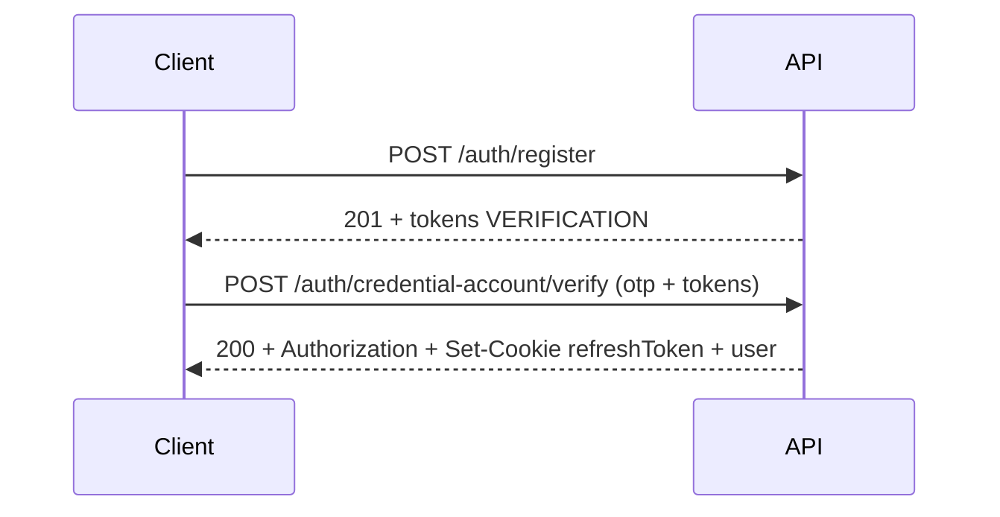
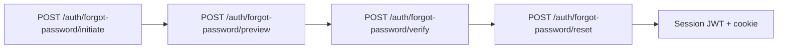

# Authentication module

This document describes how **credential-based** sign-up, login, OTP verification, password reset, and session refresh work in this API. All routes are mounted under **`/api/v1`** (see `src/config/app.config.ts`), so auth URLs look like **`/api/v1/auth/...`**.

Request bodies that include **`phoneNumber`** must use **E.164** format (`+` and country code; see **`PhoneNumberSchema`** in `auth.schema.ts`).

For a machine-readable contract (Postman import, codegen, docs), use **`auth.spec.yml`** (OpenAPI 3).

---

## Response shape

Successful JSON responses follow:

```json
{
  "success": true,
  "message": "…",
  "data": {}
}
```

Errors use `success: false` and an appropriate HTTP status (400, 401, 404, etc.).

---

## Sessions: access token + refresh cookie

When the server establishes a session (full login, OTP verify after registration, or password reset completion), it:

1. Sets the **`Authorization`** response header to **`Bearer <accessToken>`** (JWT).
2. Sets an **httpOnly** cookie named **`refreshToken`** (see `AuthTokenUtil` in `jwt.util.ts`).

Clients should:

- Send **`Authorization: Bearer <accessToken>`** on requests that need the access token.
- Send the **`refreshToken`** cookie on requests that must refresh or validate the session (this codebase parses cookies from the `Cookie` header).

The **`GET /auth/user`** handler runs **`authenticate`**: it requires a non-empty **`Cookie`** header containing **`refreshToken`**. An **`Authorization: Bearer <accessToken>`** header is optional; if the access token is present and valid, it is rotated and returned on the response. If the access token is missing or expired, the server falls back to the refresh token and still returns a new **`Authorization`** header when valid.

**`POST /auth/refresh-token`** expects the **`refreshToken`** cookie (see that route’s implementation in `auth.service.ts`).

**Logout** (`DELETE /auth/logout`) clears the refresh cookie.

---

## Token objects in JSON (`data.tokens`)

Many steps return opaque server tokens inside **`data.tokens`**, each with:

- **`key`**: matches **`AuthTokenType`** — `VERIFICATION`, `FORGOT_PASSWORD`, or `RESET_PASSWORD` (see `prisma/schema.prisma`).
- **`value`**: UUID string stored as `AuthToken.token`; pass it forward in the next request in the JSON **`tokens`** array where the route’s body schema (`OTPSchema`, `OTPVerifySchema`, `ResetPasswordSchema`) requires it.

---

## Flow 1: Register → verify phone → session



1. **`POST /auth/register`** — Body: **`fullName`**, **`phoneNumber`** (E.164: `+` and country code, see `PhoneNumberSchema`), **`password`**, optional **`email`**. Creates user + pending credentials account, sends SMS OTP, returns **`VERIFICATION`** token(s) for the next step.
2. **`POST /auth/credential-account/verify`** — Body: **`phoneNumber`**, **`otp`**, **`tokens`** (include `VERIFICATION`), optional **`rememberMe`**. On success, activates the account and returns a **full session** (JWT header + refresh cookie + user in `data`).

Optional: **`POST /auth/credential-account/preview`** with body matching **`OTPSchema`** (`phoneNumber` + `tokens`): resolves the **`VERIFICATION`** entry in `tokens` and checks expiry/preview. **`POST /auth/credential-account/resend`** refreshes OTP using the current `tokens`.

---

## Flow 2: Login

Login is controlled by flags on **`POST /auth/login`** (see **`LoginSchema`**):

| Mode     | Flags                       | Behaviour                                                                                                                                                                                                                               |
| -------- | --------------------------- | --------------------------------------------------------------------------------------------------------------------------------------------------------------------------------------------------------------------------------------- |
| Password | `isLoginWithPassword: true` | **`password`** must be non-empty. If credentials account is still pending/inactive, returns OTP **`tokens`** (same as register verify path). If active (and role matches `loginRole` for non-USER), returns **session** (JWT + cookie). |
| OTP      | `isLoginWithOtp: true`      | **`password`** can be omitted. Sends verification OTP; returns **`tokens`** for **`/auth/credential-account/verify`**. May create a user + pending account if the phone is new.                                                         |

Body always includes **`phoneNumber`** in E.164 form. Optional **`email`**. **`password`** is required only when **`isLoginWithPassword`** is true (validated in `LoginSchema` `superRefine`).

---

## Flow 3: Forgot password



1. **`initiate`** — Phone only; returns **`FORGOT_PASSWORD`** in `tokens`.
2. **`preview`** / **`resend`** — Carry `phoneNumber` + `tokens` with `FORGOT_PASSWORD`.
3. **`verify`** — Submit OTP + `tokens`; response includes **`RESET_PASSWORD`** in `tokens`.
4. **`reset`** — New `password` + `tokens` with `RESET_PASSWORD`; on success returns a **new session**.

---

## Flow 4: Refresh access token

**`POST /auth/refresh-token`** — Requires **`refreshToken`** cookie. Responds with **`Authorization: Bearer <newAccessToken>`** and may refresh the cookie when the sliding “remember me” window applies.

---

## Postman workflow tips

1. Import **`auth.spec.yml`** (File → Import).
2. Set **`baseUrl`** = `http://localhost:<port>/api/v1` (port from `SERVER_PORT`, default `5000`).
3. Turn on **cookie jar** for the environment so `refreshToken` is stored and sent after the first successful auth response.
4. After login/verify/reset, copy **`Authorization`** from the response **Tests** or use **Authorization → Bearer Token** and paste the access token; or rely on cookie-only calls where the spec describes it.
5. Chain requests: save `data.tokens` from responses into collection variables for the next body.

---

## Source of truth

| Area          | Location                           |
| ------------- | ---------------------------------- |
| Routes        | `src/route/auth.route.ts`          |
| Validation    | `src/service/auth/auth.schema.ts`  |
| Handlers      | `src/service/auth/auth.service.ts` |
| JWT & cookies | `src/service/auth/jwt.util.ts`     |
